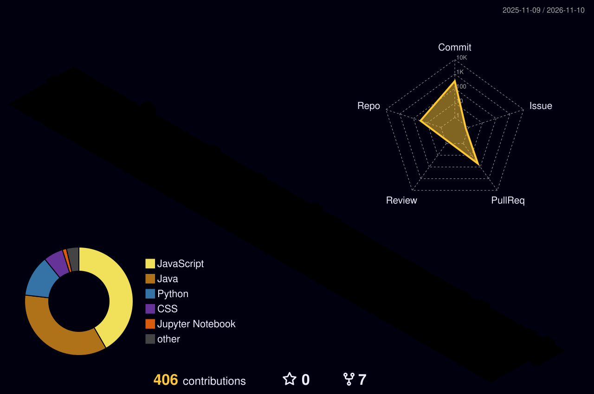
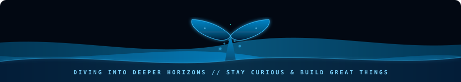

<!-- ═══════════════════════════════════════════════════════════════════ -->
<!--  🐋 NGUYEN KHOA — DEEP OCEAN & BLUE WHALE DEVELOPER PORTFOLIO      -->
<!--  Theme: Abyssal Blue, Seafoam Aqua & Bioluminescent Cyan          -->
<!-- ═══════════════════════════════════════════════════════════════════ -->

<div align="center">
  <!-- Animated Swimming Blue Whale Header with Light Rays & Bioluminescent Depth -->
  
</div>

<div align="center">

  <!-- Animated Typing Subtitle -->
  <a href="https://git.io/typing-svg">
    
  </a>

  <br>

  <!-- Deep Ocean Shields Badges -->
  <a href="https://github.com/Khoa18062005?tab=followers">
    
  </a>
  &nbsp;
  <a href="https://github.com/Khoa18062005?tab=repositories">
    
  </a>
  &nbsp;
  

</div>

<br>

<!-- ═════════════════════ SOCIAL CONTACT CHANNELS ═════════════════════ -->

<div align="center">
  <a href="https://github.com/Khoa18062005" target="_blank" title="GitHub Profile">
    
  </a>
  &nbsp;&nbsp;&nbsp;&nbsp;
  <a href="https://www.facebook.com/quockhoa.nguyen.71404" target="_blank" title="Facebook Profile">
    
  </a>
  &nbsp;&nbsp;&nbsp;&nbsp;
  <a href="https://www.instagram.com/nqkhoa_lks1806/" target="_blank" title="Instagram Profile">
    
  </a>
  &nbsp;&nbsp;&nbsp;&nbsp;
  <a href="mailto:nguyenquockhoa00725005@gmail.com" title="Gửi thư trực tiếp">
    
  </a>
</div>

<div align="center">
  <br>
  <sub>📋 <em>Nhấp vào biểu tượng copy góc phải để sao chép địa chỉ email:</em></sub>
</div>

```text
nguyenquockhoa00725005@gmail.com
```

<br>

<table align="center" width="100%">
<tr>
<td width="50%" valign="top">

### ◈ Acoustic Logbook

```bash
nautilus@abyss:~$ cat telemetry_manifest.json
```

```json
{
  "name": "Nguyen Khoa",
  "callsign": "BlueWhale-05",
  "status": "University Software Engineering Student",
  "specialization": "Full-Stack Development & Architecture",
  "operating_depth": "Pacific Trench // 3,820m",
  "current_expeditions": [
    "High-Concurrency Distributed Systems",
    "Microservice Ecosystems & Redis Redlock",
    "Decoupled Full-Stack Architecture",
    "Applied Machine Learning Pipelines"
  ],
  "philosophy": "Like a blue whale navigating the boundless abyss, navigate complexity with calm precision and clean code."
}
```

</td>
<td width="50%" valign="top">

### ◈ Oceanic Telemetry

```yaml
# ocean_telemetry.yml
submersible: "Nautilus-Mk.IV"
hull_integrity: "100% nominal"
acoustic_frequency: "20Hz resonance"
ballast_water: "purified"

depth_readings:
  surface_engineering:   ████████████████░░ 88%
  backend_concurrency:   █████████████████░ 92%
  distributed_caching:   ███████████████░░░ 80%
  resilience_devops:     ████████████░░░░░░ 70%

sonar_grid:
  ping_rate: "Active (continuous sweep)"
  connection: "Encrypted WebSocket"
```

</td>
</tr>
</table>

---

<!-- ═══════════════════ BATHYMETRIC TECH ECOSYSTEM ═══════════════════ -->

<div align="center">

## ◈ Bathymetric Tech Ecosystem

<p><em>Mapping technology layers to oceanic depth zones — from sunlit interfaces to deep persistent trenches</em></p>

  <!-- Bathymetric Ocean Depth Visualization (Replaces Skill Bars) -->
  

</div>

<br>

<div align="center">

<!-- Acoustic Marine Sonar Sweep -->
  

</div>

<br>

<div align="center">

<p align="center">
  <a href="https://skillicons.dev">
    
  </a>
</p>
<p align="center">
  <a href="https://skillicons.dev">
    
  </a>
</p>
<p align="center">
  <a href="https://skillicons.dev">
    
  </a>
</p>

</div>

---

<!-- ═══════════════════ FLAGSHIP EXPEDITIONS / PROJECTS ═══════════════════ -->

<div align="center">

## ◈ Flagship Engineering Expeditions

<p><em>Production-grade platforms engineered for high throughput, fault tolerance, and clean modularity</em></p>

</div>

<table align="center" width="100%">
  <tr>
    <td width="50%" valign="top">
      <div align="left">
        <h4>◈ Abyssal Cinema Platform — CineBook</h4>
        <p>Enterprise cinema ticketing platform engineered for <strong>extreme concurrent traffic</strong>. Solves distributed seat booking collisions using <strong>Redis Redlock distributed locking</strong>, accompanied by an intelligent real-time customer assistant.</p>
        <p>
          
          
          
          
        </p>
        <p>
          <a href="https://github.com/Khoa18062005"></a>
          
        </p>
      </div>
    </td>
    <td width="50%" valign="top">
      <div align="left">
        <h4>◈ Nautilus Property Platform — MayVang</h4>
        <p>Full-stack hotel reservation and property management ecosystem. Built on a <strong>decoupled micro-architecture</strong> separating Java Spring Boot core backend microservices from high-performance reactive web clients.</p>
        <p>
          
          
          
          
        </p>
        <p>
          <a href="https://github.com/Khoa18062005"></a>
          <a href="https://github.com/Khoa18062005"></a>
        </p>
      </div>
    </td>
  </tr>

  <tr>
    <td width="50%" valign="top">
      <div align="left">
        <h4>◈ Leviathan Intelligence — Sentiment Analysis Engine</h4>
        <p>End-to-end Machine Learning pipeline for Vietnamese and multilingual text classification. Features high-dimensional tokenization, custom neural feature extraction, and lightweight decoupled inference micro-endpoints.</p>
        <p>
          
          
          
          
        </p>
        <p>
          <a href="https://github.com/Khoa18062005"></a>
          <a href="https://github.com/Khoa18062005"></a>
        </p>
      </div>
    </td>
    <td width="50%" valign="top">
      <div align="left">
        <h4>◈ Deep Blue Algorithmic Agent — Heuristic Caro AI</h4>
        <p>Autonomous strategic game agent capable of competitive play on arbitrary NxN boards. Implements <strong>dynamic heuristic evaluation functions</strong> with <strong>Alpha-Beta Pruning</strong> and branch optimization for sub-second moves.</p>
        <p>
          
          
          
        </p>
        <p>
          <a href="https://github.com/Khoa18062005"></a>
          
        </p>
      </div>
    </td>
  </tr>
</table>

<br>

<div align="center">

### ◈ Auxiliary Fleet Repositories

| Fleet Repository | Technology Stack | Core Architecture & Focus | Access |
| :--- | :--- | :--- | :--- |
| **Encrypted File Vault** | `C#` `.NET Core` | Local AES-256 filesystem encryption utility | [Inspect Repo →](https://github.com/Khoa18062005) |
| **Ocean Commerce Engine** | `React` `Node.js` `Express` | Full-cycle e-commerce store with catalog & cart | [Inspect Repo →](https://github.com/Khoa18062005) |
| **Submersible Task Manager** | `Java` `Desktop UI` | Desktop productivity scheduler & habit tracker | [Inspect Repo →](https://github.com/Khoa18062005) |
| **Precision Scientific Engine** | `Java` `Algorithmic UI` | Multi-mode functional arithmetic calculator | [Inspect Repo →](https://github.com/Khoa18062005) |

</div>

---

<!-- ═══════════════════ LIVE TELEMETRY & ACTIVITY MONITOR ═══════════════════ -->

<div align="center">

## ◈ Abyssal Telemetry & Live Activity

  <!-- Custom Animated ECG / Sonar Pulse Monitor -->
  

</div>

<br>

<div align="center">
  
  &nbsp;
  
  <br><br>
  
</div>

<br>

<!-- 3D Contribution Skyline (Generated by GitHub Action) -->
<div align="center">
  <picture>
    <source media="(prefers-color-scheme: dark)" srcset="./profile-3d-contrib/profile-night-rainbow.svg" />
    <source media="(prefers-color-scheme: light)" srcset="./profile-3d-contrib/profile-green-animate.svg" />
    
  </picture>
</div>

<br>

<!-- Contribution Snake Animation -->
<div align="center">
  <picture>
    <source media="(prefers-color-scheme: dark)" srcset="https://raw.githubusercontent.com/Khoa18062005/Khoa18062005/output/github-contribution-grid-snake-dark.svg" />
    <source media="(prefers-color-scheme: light)" srcset="https://raw.githubusercontent.com/Khoa18062005/Khoa18062005/output/github-contribution-grid-snake.svg" />
    
  </picture>
</div>

---

<!-- ═══════════════════ OCEAN PHILOSOPHY ═══════════════════ -->

<div align="center">

<!-- Ocean Quote -->


</div>

---

<!-- ═══════════════════ MAJESTIC WHALE FOOTER ═══════════════════ -->

<div align="center">
  <!-- Animated Blue Whale Fluke / Wave Breaching Footer -->
  
</div>

<div align="center">
  <br>
  
  ```
                                         __
                                     _.-~  )
                          _..--~~~~,'   ,-/     _
                       .-'. . . .'   ,-','    ,' )
                     ,'. . . _   ,--'  /(__.-'  ,'
                   ,'. . .  (@)'---./   '-.   '-.
                 ,'. . . . _----_   /       `'-. '.
                / . . . . 'of_  '--'            `-'
               / . . . . ._____|
              | . . . . . . . .|
              | . . . . . . . .|
               \ . . . . . . ./   WHALE RESIDUE DETECTED:
                \ . . . . . ./    CALM • RESILIENT • LIMITLESS
                 `--._____.-'
  ```
  
  <sub>≋ Navigating the digital ocean with curiosity, resilience, and clean architecture ≋</sub>
</div>
