<!-- ═══════════════════════════════════════════════════════════════════ -->
<!--  ⭐ NGUYEN KHOA — STEVEN UNIVERSE & CRYSTAL GEMS DEVELOPER PORTFOLIO -->
<!--  Theme: Rose Quartz Pink, Star Yellow & Cosmic Gem Twilight           -->
<!-- ═══════════════════════════════════════════════════════════════════ -->

<div align="center">
  <!-- Animated Steven Universe & Rose Quartz Shield Cosmic Header -->
  
</div>

<br>

<div align="center">

  <!-- Animated Typing Subtitle -->
  <a href="https://git.io/typing-svg">
    
  </a>

  <br>

  <!-- Crystal Gem Shields Badges -->
  <a href="https://github.com/Khoa18062005?tab=followers">
    
  </a>
  &nbsp;
  <a href="https://github.com/Khoa18062005?tab=repositories">
    
  </a>
  &nbsp;
  

</div>

<br>

<!-- ═════════════════════ SOCIAL CONTACT CHANNELS ═════════════════════ -->

<div align="center">
  <a href="https://github.com/Khoa18062005" target="_blank" title="GitHub Profile">
    
  </a>
  &nbsp;&nbsp;&nbsp;&nbsp;
  <a href="https://www.facebook.com/quockhoa.nguyen.71404" target="_blank" title="Facebook Profile">
    
  </a>
  &nbsp;&nbsp;&nbsp;&nbsp;
  <a href="https://www.instagram.com/nqkhoa_lks1806/" target="_blank" title="Instagram Profile">
    
  </a>
  &nbsp;&nbsp;&nbsp;&nbsp;
  <a href="mailto:nguyenquockhoa00725005@gmail.com" title="Gửi thư trực tiếp">
    
  </a>
</div>

<br>

<table align="center" width="100%">
<tr>
<td width="50%" valign="top">

### ◈ Crystal Heart Manifest

```bash
steven@crystal-temple:~$ cat gem_manifest.json
```

```json
{
  "name": "Nguyen Khoa",
  "callsign": "Steven-Universe-05",
  "status": "IT Student @ HCMUTE",
  "origin": "Dong Nai, Vietnam",
  "gem_affinity": "Rose Quartz Core // Pink Diamond Lineage",
  "fusion_role": "Full-Stack System Architect",
  "sanctuary": "Beach City Crystal Temple",
  "active_missions": [
    "High-Concurrency Shielding & Redis Redlock",
    "Decoupled Clean Architecture & Stable Gem Fusions",
    "Reactive Microservices & Resilient Gateways",
    "Empathetic Machine Learning & NLP Pipelines"
  ],
  "gem_philosophy": "If every porkchop were perfect, we wouldn't have hotdogs. Turn system anomalies into resilience through empathy, calm precision, and clean code."
}
```

</td>
<td width="50%" valign="top">

### ◈ Temple Telemetry

```yaml
# crystal_telemetry.yml
sanctuary: "Crystal-Temple-Sanctum"
crystal_heart: "100% nominal resonance"
shield_frequency: "Rose Quartz Harmonics (432Hz)"
warp_pad: "Multi-cluster synchronized"

fusion_power_levels:
  client_interface:       ████████████████░░ 88%
  backend_concurrency:    █████████████████░ 92%
  redis_shield_caching:   ███████████████░░░ 80%
  warp_devops_cloud:      ████████████░░░░░░ 70%

gem_sonar:
  ping_rate: "Active (continuous Beach City sweep)"
  connection: "Encrypted WebSocket Stream"
```

</td>
</tr>
</table>

---

<!-- ═══════════════════ GEM FUSION TECH ECOSYSTEM ═══════════════════ -->

<div align="center">

## ◈ Crystal Gem Fusion Tech Ecosystem

<p><em>Mapping software engineering layers to the sacred tiers of the Crystal Temple — from Sunlit Warp Terraces to Subterranean Core Sanctums</em></p>

  <!-- Crystal Matrix Visualization -->
  

</div>

<br>

<div align="center">

<!-- Gem Tech Sonar Scanner -->
  

</div>

<br>

<div align="center">

<p align="center">
  <a href="https://skillicons.dev">
    
  </a>
</p>
<p align="center">
  <a href="https://skillicons.dev">
    
  </a>
</p>
<p align="center">
  <a href="https://skillicons.dev">
    
  </a>
</p>

</div>

---

<!-- ═══════════════════ FLAGSHIP EXPEDITIONS / PROJECTS ═══════════════════ -->

<div align="center">

## ◈ Flagship Engineering Expeditions

<p><em>Production-grade platforms engineered for high throughput, fault tolerance, and clean modularity</em></p>

</div>

<table align="center" width="100%">
  <tr>
    <td width="50%" valign="top">
      <div align="left">
        <h4>◈ Rose Shield Cinema Platform — CineBook</h4>
        <p>Enterprise cinema ticketing platform engineered for <strong>extreme concurrent traffic</strong>. Solves distributed seat booking collisions using <strong>Redis Redlock distributed locking (Rose's Shield)</strong>, accompanied by an intelligent real-time customer assistant.</p>
        <p>
          
          
          
          
        </p>
        <p>
          <a href="https://github.com/Khoa18062005"></a>
          
        </p>
      </div>
    </td>
    <td width="50%" valign="top">
      <div align="left">
        <h4>◈ Crystal Temple Property Platform — MayVang</h4>
        <p>Full-stack hotel reservation and property management ecosystem. Built on a <strong>decoupled micro-architecture</strong> separating Java Spring Boot core backend microservices from high-performance reactive web clients.</p>
        <p>
          
          
          
          
        </p>
        <p>
          <a href="https://github.com/Khoa18062005"></a>
          <a href="https://github.com/Khoa18062005"></a>
        </p>
      </div>
    </td>
  </tr>

  <tr>
    <td width="50%" valign="top">
      <div align="left">
        <h4>◈ Crystal Empathy Intelligence — Sentiment Analysis Engine</h4>
        <p>End-to-end Machine Learning pipeline for Vietnamese and multilingual text classification. Inspired by Steven's empathetic resonance — features high-dimensional tokenization, custom neural feature extraction, and lightweight inference micro-endpoints.</p>
        <p>
          
          
          
          
        </p>
        <p>
          <a href="https://github.com/Khoa18062005"></a>
          <a href="https://github.com/Khoa18062005"></a>
        </p>
      </div>
    </td>
    <td width="50%" valign="top">
      <div align="left">
        <h4>◈ Strategic Sapphire Agent — Heuristic Caro AI</h4>
        <p>Autonomous strategic game agent capable of competitive play on arbitrary NxN boards. Implements <strong>dynamic heuristic evaluation functions</strong> with <strong>Alpha-Beta Pruning</strong> (Sapphire's future calculation) for sub-second moves.</p>
        <p>
          
          
          
        </p>
        <p>
          <a href="https://github.com/Khoa18062005"></a>
          
        </p>
      </div>
    </td>
  </tr>
</table>

<br>

<div align="center">

### ◈ Auxiliary Fleet Repositories

| Temple Repository | Technology Stack | Core Architecture & Focus | Access |
| :--- | :--- | :--- | :--- |
| **Encrypted File Vault** | `C#` `.NET Core` | Local AES-256 filesystem encryption utility | [Inspect Repo →](https://github.com/Khoa18062005) |
| **Crystal Commerce Engine** | `React` `Node.js` `Express` | Full-cycle e-commerce store with catalog & cart | [Inspect Repo →](https://github.com/Khoa18062005) |
| **Temple Task Manager** | `Java` `Desktop UI` | Desktop productivity scheduler & habit tracker | [Inspect Repo →](https://github.com/Khoa18062005) |
| **Precision Scientific Engine** | `Java` `Algorithmic UI` | Multi-mode functional arithmetic calculator | [Inspect Repo →](https://github.com/Khoa18062005) |

</div>

---

<!-- ═══════════════════ LIVE TELEMETRY & ACTIVITY MONITOR ═══════════════════ -->

<div align="center">

## ◈ Crystal Heart Telemetry & Live Activity

  <!-- Custom Animated Crystal Heart Resonance Monitor -->
  

</div>

<br>

<div align="center">
  
  &nbsp;
  
  <br><br>
  
</div>

<br>

<!-- 3D Contribution Skyline (Generated by GitHub Action) -->
<div align="center">
  <picture>
    <source media="(prefers-color-scheme: dark)" srcset="./profile-3d-contrib/profile-night-rainbow.svg" />
    <source media="(prefers-color-scheme: light)" srcset="./profile-3d-contrib/profile-green-animate.svg" />
    
  </picture>
</div>

<br>

<!-- Contribution Snake Animation -->
<div align="center">
  <picture>
    <source media="(prefers-color-scheme: dark)" srcset="https://raw.githubusercontent.com/Khoa18062005/Khoa18062005/output/github-contribution-grid-snake-dark.svg" />
    <source media="(prefers-color-scheme: light)" srcset="https://raw.githubusercontent.com/Khoa18062005/Khoa18062005/output/github-contribution-grid-snake.svg" />
    
  </picture>
</div>

---

<!-- ═══════════════════ STEVEN'S PHILOSOPHY ═══════════════════ -->

<div align="center">

<!-- Crystal Gems Quote -->


</div>

---

<!-- ═══════════════════ CRYSTAL GEMS FOOTER ═══════════════════ -->

<div align="center">
  <!-- Beach City Twilight & Star Warp Pad Footer -->
  
</div>

<div align="center">
  <br>
  <sub>★ We will always find a way — Crafting resilient systems with empathy, fusion, and clean architecture ★</sub>
</div>
