<!-- ╔══════════════════════════════════════════════════════════════════╗ -->
<!-- ║  🌊 KHOA NGUYEN — GitHub Profile                               ║ -->
<!-- ║  Theme: Ocean Blue & Teal | Style: Cyberpunk Terminal          ║ -->
<!-- ╚══════════════════════════════════════════════════════════════════╝ -->

<div align="center">
  
</div>

<div align="center">

  <!-- Animated wave text - different from typing SVG -->
  <a href="https://git.io/typing-svg">
    
  </a>

  <br>

  <!-- Status badges - hexagonal style, different from Thien's flat-square -->
  <a href="https://github.com/Khoa18062005?tab=followers">
    
  </a>
  &nbsp;
  <a href="https://github.com/Khoa18062005?tab=repositories">
    
  </a>
  &nbsp;
  

</div>

<br>

<!-- ═══════════════════════ TERMINAL ABOUT ME ═══════════════════════ -->

<div align="center">

```
╔═══════════════════════════════════════════════════════════════════════════╗
║                                                                         ║
║   ███╗   ██╗ ██████╗ ██╗   ██╗██╗   ██╗███████╗███╗   ██╗              ║
║   ████╗  ██║██╔════╝ ██║   ██║╚██╗ ██╔╝██╔════╝████╗  ██║              ║
║   ██╔██╗ ██║██║  ███╗██║   ██║ ╚████╔╝ █████╗  ██╔██╗ ██║              ║
║   ██║╚██╗██║██║   ██║██║   ██║  ╚██╔╝  ██╔══╝  ██║╚██╗██║              ║
║   ██║ ╚████║╚██████╔╝╚██████╔╝   ██║   ███████╗██║ ╚████║              ║
║   ╚═╝  ╚═══╝ ╚═════╝  ╚═════╝    ╚═╝   ╚══════╝╚═╝  ╚═══╝              ║
║                         K H O A                                          ║
║                                                                         ║
╚═══════════════════════════════════════════════════════════════════════════╝
```

</div>

<table align="center">
<tr>
<td width="50%">

### 🖥️ Terminal Session

```bash
khoa@universe:~$ cat about_me.json
```

```json
{
  "name": "Nguyen Khoa",
  "status": "🎓 University Student",
  "role": "Full-Stack Developer",
  "location": "Vietnam 🇻🇳",
  "currently_learning": [
    "Cloud Architecture",
    "System Design Patterns",
    "AI/ML Integration"
  ],
  "fun_fact": "I debug with console.log and I'm proud of it 😄",
  "motto": "Code is poetry, bugs are just plot twists"
}
```

</td>
<td width="50%">

### 📡 System Status

```yaml
# system_status.yml
uptime: "since 2005-06-18"
kernel: "student-v4.0-lts"
shell: "zsh with oh-my-zsh"

processes:
  learning:    ▓▓▓▓▓▓▓▓▓▓▓▓▓▓▓░░░ 85%
  coding:      ▓▓▓▓▓▓▓▓▓▓▓▓▓▓▓▓░░ 90%
  debugging:   ▓▓▓▓▓▓▓▓▓▓▓▓░░░░░░ 70%
  coffee_intake: ▓▓▓▓▓▓▓▓▓▓▓▓▓▓▓▓▓▓ 100%

network:
  linkedin: "connected"
  github:   "active"
  email:    "listening"
```

</td>
</tr>
</table>

---

<!-- ═══════════════════ TECH RADAR VISUALIZATION ═══════════════════ -->

<div align="center">

##  &nbsp; Tech Radar &nbsp; 

  

</div>

<br>

<div align="center">

## 🛠️ Technological Arsenal

<br>

<p align="center">
  <a href="https://skillicons.dev">
    
  </a>
</p>
<p align="center">
  <a href="https://skillicons.dev">
    
  </a>
</p>
<p align="center">
  <a href="https://skillicons.dev">
    
  </a>
</p>

</div>

<br>

<div align="center">
  
</div>

---

<!-- ═══════════════════ PROJECTS - TIMELINE STYLE ═══════════════════ -->

<div align="center">

## 🚀 Mission Log — Featured Projects

</div>

> [!NOTE]
> Each project represents a unique challenge conquered. Click to explore the source code.

<details>
<summary><h3>🔮 Project Alpha — <em>Click to Expand</em></h3></summary>

<br>

<div align="center">

| | |
|:--|:--|
| **Mission** | 🎯 Coming Soon — Exciting project in development |
| **Status** | 🟢 `IN_PROGRESS` |
| **Tech** |    |
| **Architecture** | Microservices • REST API • Real-time WebSocket |

</div>

```
📦 project-alpha
├── 🎨 client/          # React SPA with real-time features
├── ⚙️  server/          # Node.js API with WebSocket
├── 🗄️  database/        # PostgreSQL + Redis caching
├── 🐳 docker/          # Containerized deployment
└── 📋 docs/            # Architecture documentation
```

</details>

<details>
<summary><h3>🌐 Project Beta — <em>Click to Expand</em></h3></summary>

<br>

<div align="center">

| | |
|:--|:--|
| **Mission** | 🎯 Coming Soon — Another groundbreaking project |
| **Status** | 🟡 `PLANNING` |
| **Tech** |    |
| **Architecture** | Clean Architecture • Domain-Driven Design |

</div>

```
📦 project-beta
├── 🧠 ml-engine/       # Python ML pipeline
├── ⚙️  api-gateway/     # Spring Boot microservice
├── 🗄️  data-layer/      # PostgreSQL with migrations
└── 📊 analytics/       # Data visualization dashboard
```

</details>

<details>
<summary><h3>🤖 Project Gamma — <em>Click to Expand</em></h3></summary>

<br>

<div align="center">

| | |
|:--|:--|
| **Mission** | 🎯 Coming Soon — AI-powered innovation |
| **Status** | 🔵 `RESEARCH` |
| **Tech** |    |
| **Architecture** | ML Pipeline • Containerized Training • API Serving |

</div>

```
📦 project-gamma
├── 🧠 model/           # Neural network architecture
├── 📊 training/        # Training pipeline & datasets  
├── 🔌 api/             # Inference API endpoint
└── 🐳 deploy/          # Docker + cloud deployment
```

</details>

---

<!-- ═══════════════════ ACTIVITY MONITOR ═══════════════════ -->

<div align="center">

## 📊 Mission Control — Live Metrics

  

</div>

<br>

<div align="center">
  
  &nbsp;
  
  <br><br>
  
</div>

---

<!-- ═══════════════════ CONTRIBUTION SNAKE ═══════════════════ -->

<div align="center">

## 🐍 Contribution Serpent

  <picture>
    <source media="(prefers-color-scheme: dark)" srcset="https://raw.githubusercontent.com/Khoa18062005/Khoa18062005/output/github-contribution-grid-snake-dark.svg" />
    <source media="(prefers-color-scheme: light)" srcset="https://raw.githubusercontent.com/Khoa18062005/Khoa18062005/output/github-contribution-grid-snake.svg" />
    
  </picture>

</div>

<br>

<!-- 3D Contribution Skyline -->
<div align="center">
  <picture>
    <source media="(prefers-color-scheme: dark)" srcset="https://raw.githubusercontent.com/Khoa18062005/Khoa18062005/main/profile-3d-contrib/profile-night-rainbow.svg" />
    <source media="(prefers-color-scheme: light)" srcset="https://raw.githubusercontent.com/Khoa18062005/Khoa18062005/main/profile-3d-contrib/profile-green-animate.svg" />
    
  </picture>
</div>

---

<!-- ═══════════════════ CONNECT SECTION ═══════════════════ -->

<div align="center">

## 🌐 Connect & Collaborate

<br>

<a href="https://github.com/Khoa18062005">
  
</a>
&nbsp;&nbsp;
<a href="https://linkedin.com/in/YOUR_LINKEDIN">
  
</a>
&nbsp;&nbsp;
<a href="mailto:YOUR_EMAIL@gmail.com">
  
</a>
&nbsp;&nbsp;
<a href="https://facebook.com/YOUR_FACEBOOK">
  
</a>

<br><br>

<!-- Spotify / Dev Quote widget -->


<br><br>

<!-- Cyberpunk Coding Animation -->


</div>

---

<!-- ═══════════════════ FOOTER ═══════════════════ -->

<div align="center">
  
</div>

<div align="center">
  <br>
  
  <br>
  
  ```
  ⠀⠀⠀⠀⠀⠀⠀⠀⠀⣠⣤⣤⣤⣤⣤⣶⣦⣤⣄⡀⠀⠀⠀⠀⠀⠀⠀⠀
  ⠀⠀⠀⠀⠀⠀⠀⢀⣴⣿⡿⠛⠉⠙⠛⠛⠛⠛⠻⢿⣿⣷⣤⡀⠀⠀⠀⠀⠀
  ⠀⠀⠀⠀⠀⠀⠀⣼⣿⠋⠀⠀⠀⠀⠀⠀⠀⢀⣀⣀⠈⢻⣿⣿⡄⠀⠀⠀⠀
  ⠀⠀⠀⠀⠀⠀⣸⣿⡏⠀⠀⠀⣠⣶⣾⣿⣿⣿⠿⠿⠿⢿⣿⣿⣿⣄⠀⠀⠀
  ⠀⠀⠀⠀⠀⠀⣿⣿⠁⠀⠀⢰⣿⣿⣯⠁⠀⠀⠀⠀⠀⠀⠀⠈⠙⢿⣷⡄⠀
  ⠀⠀⣀⣤⣴⣶⣶⣿⡟⠀⠀⢸⣿⣿⣿⣆⠀  < Happy   ⠀⠀⠙⣷⡀
  ⠀⢰⣿⡟⠋⠉⣹⣿⡇⠀⠀⠀⠻⣿⣿⣿⣷⣦⡀  Coding! > ⠀⢻⡇
  ⠀⢸⣿⡇⠀⠀⣿⣿⡇⠀⠀⠀⠀⠀⠉⠻⠿⣿⣿⣿⣷⡀⠀⠀⠀⠀⠀⣸⣿
  ⠀⢸⣿⡇⠀⠀⣿⣿⡇⠀⠀⠀⠀⠀⠀⠀⠀⠀⠉⠻⣿⣿⣄⠀⠀⠀⣰⣿⠇
  ⠀⠘⣿⣷⠀⢀⣿⣿⣿⡄⠀⠀⠀⠀⠀⠀⠀⠀⠀⠀⠈⣿⣿⣿⣶⣿⣿⡏⠀
  ⠀⠀⠻⣿⣷⣿⣿⠏⠀⠙⢦⡀⠀⠀⠀⠀⠀⠀⢀⣠⣾⣿⣿⣿⣿⡿⠋⠀⠀
  ⠀⠀⠀⠈⠻⣿⡏⠀⠀⠀⠀⠙⠳⣶⣤⣤⣤⣶⣿⡿⠿⠛⢻⡿⠋⠀⠀⠀⠀
  ⠀⠀⠀⠀⠀⠈⠀⠀⠀⠀⠀⠀⠀⠀⠉⠉⠉⠁⠀⠀⠀⠀⠈⠀⠀⠀⠀⠀⠀
  ```
  
  <sub>⚡ Powered by caffeine, curiosity, and countless Stack Overflow tabs ⚡</sub>
</div>
